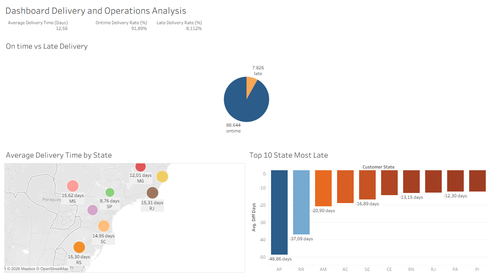

# Olist E-Commerce — Delivery and Operations Analysis

## Project Overview

This project explores delivery performance using the Olist Brazilian E-Commerce dataset. The analysis focuses on comparing average actual delivery time with estimated delivery time across customer states, evaluating the percentage of late deliveries, and identifying states with the largest average delivery delays.

Through this analysis, I aim to understand how well Olist manages its delivery estimates and identify differences in delivery performance across regions.

## Business Objectives

This project covers three business cases to evaluate Olist's delivery performance.

### Business Case 1: Average Actual vs. Estimated Delivery Time by State

**Objective:** Compare average actual delivery time with average estimated delivery time across customer states to evaluate delivery performance and understand the differences between actual and estimated delivery duration in each state.

### Business Case 2: Late Delivery Rate

**Objective:** Calculate the percentage of orders delivered later than the estimated delivery date to evaluate overall delivery performance and determine how frequently delivery delays occur.

### Business Case 3: Average Delivery Delay by State

**Objective:** Identify customer states with the highest average delivery delay to understand regional differences and highlight areas that may require further evaluation.

## Dataset

This project uses the Olist Brazilian E-Commerce Public Dataset from Kaggle.

**Main Tables Used:**
- `orders_dataset`
- `customers_dataset`

**Data Scope:**
- Delivery analysis focuses on orders with available actual delivery dates.
- Actual delivery time is calculated from the purchase date to the actual delivery date.
- Estimated delivery time is calculated from the purchase date to the estimated delivery date.
- Delivery performance is evaluated by comparing actual delivery time with estimated delivery time.
- Customer state is used to examine differences in delivery performance across regions.

## Tools & Technologies

- Python
- Pandas
- NumPy
- Matplotlib
- Seaborn
- Jupyter Notebook
- Tableau

## Analysis Workflow

1. **Import Libraries** — Import Python libraries needed for data analysis and visualization.
2. **Data Gathering** — Load the orders and customers datasets.
3. **Data Understanding** — Explore dataset structure, dimensions, column names, and data types.
4. **Data Quality Assessment & Cleaning** — Check missing values, duplicates, and data inconsistencies, then handle relevant issues.
5. **Data Preparation** — Merge datasets, convert date columns, filter relevant orders, and calculate actual and estimated delivery time.
6. **Exploratory Data Analysis (EDA)** — Compare average actual and estimated delivery time by state, calculate the late delivery rate, and examine average delivery delays across states.
7. **Key Insights** — Summarize the main findings from the analysis.
8. **Business Implications** — Discuss potential areas for evaluating delivery estimates and regional delivery performance.

## Key Findings

### Business Case 1: Average Actual vs. Estimated Delivery Time by State

- Average actual delivery time was generally shorter than average estimated delivery time across customer states.
- The difference between actual and estimated delivery time varied across states.
- AC recorded an average actual delivery time of 21.04 days, compared with an average estimated delivery time of 41.11 days.

### Business Case 2: Late Delivery Rate

- 88,644 orders (91.89%) were delivered on time.
- 7,826 orders (8.11%) were delivered later than the estimated delivery date.

### Business Case 3: Average Delivery Delay by State

- Average delivery delay varied across customer states.
- AP recorded the largest average difference at approximately -48.86 days, followed by RR at -37.09 days and AM at -20.90 days.
- These results should be interpreted carefully because the number of late orders in some states was relatively small.

## Dashboard Preview

The dashboard brings together the main findings from this analysis, covering average actual versus estimated delivery time by state, the percentage of late deliveries, and average delivery delay across states.

### Interactive Dashboard

**[View the Interactive Dashboard on Tableau Public](https://public.tableau.com/app/profile/adin4572/viz/DashboardDeliveryandOperationsAnalysis/DashboardDeliveryandOperationsAnalysis)**

### Dashboard Screenshot



## Business Implications

- **Review delivery estimates:** The difference between actual and estimated delivery time may provide an opportunity to evaluate whether delivery estimates can be made more accurate for customers.
- **Monitor late deliveries:** Although most orders arrived on time, 8.11% experienced delays. Monitoring this percentage can help track delivery performance and identify changes over time.
- **Evaluate regional performance:** Differences in delivery delays across states may help identify regions that need further evaluation. However, results from states with small numbers of late orders should be interpreted cautiously.

## Repository Structure

```text
Olist-Delivery-and-Operations/
├── README.md
├── Delivery and Operations Analysis.ipynb
└── Dashboard/
    └── Dashboard_Delivery_and_Operations_Analysis.png
```

## Conclusion

This analysis provides an overview of Olist's delivery performance by comparing average actual delivery time with estimated delivery time across customer states, measuring the percentage of late deliveries, and identifying states with the largest average delivery delay.

The results show that most orders were delivered within the estimated timeframe, although a portion of orders experienced delays. Delivery performance also varied across states, providing a starting point for evaluating delivery estimates and identifying regions that may require further attention.

## Project Category

**Data Analysis | E-Commerce | Delivery & Operations Analysis**

**Dataset:** Olist Brazilian E-Commerce Public Dataset
